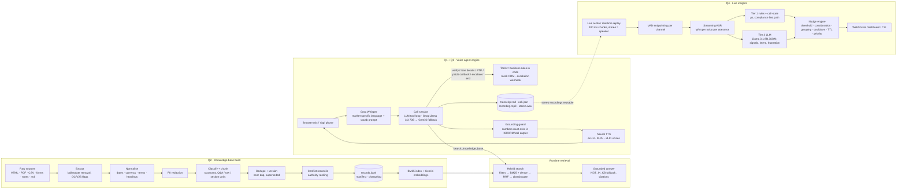

# Architecture

## Key design decisions

| Decision | Why | Trade-off |
|---|---|---|
| One engine for web UI and Vapi (`custom-llm` endpoint) | Same tools, KB grounding and guards on every channel; Vapi only adds telephony, barge-in, ASR/TTS | Requires a public URL (tunnel) for Vapi |
| Business rules in tools, not in the prompt | Verification, PTP classification, callback windows, disposition are deterministic and testable | More code than a prompt-only bot |
| KB retrieved per question via a tool | Satisfies "do not hardcode FAQs"; answers carry citations; KB updates need no prompt change | One extra LLM step (~300–600 ms) on policy questions |
| Grounding guard on numbers | Most damaging hallucinations in lending are fees, dates, percentages; checking them is cheap and objective | Doesn't catch non-numeric fabrications (mitigated by tool-only facts + NOT_IN_KB) |
| Fixed, pre-approved lines for disclosure, fallback, escalation, closing | Compliance text must not drift; also guarantees localized fallbacks never switch to English | Less variety |
| Hybrid BM25 + embeddings with RRF + abstention | Lexical handles exact terms (EMI, UTR, BPKB), dense handles paraphrase/code-switching; abstention prevents near-miss answers | Thresholds need calibration per corpus |
| Authority-ranked conflict reconciliation | Real corpora disagree (playbook said 5-day grace, policy says 3); the approved policy wins, original kept for owners | Needs a maintained authority table |
| Q4 two-tier signals | Rules give sub-ms, high-precision compliance nudges; LLM adds recall on fuzzy signals and vetoes false rule hits | LLM path adds ~0.3–0.8 s |
| Nudge text from an approved playbook | Agents receive compliant wording; LLM only detects + quotes evidence | Less tailored phrasing |
